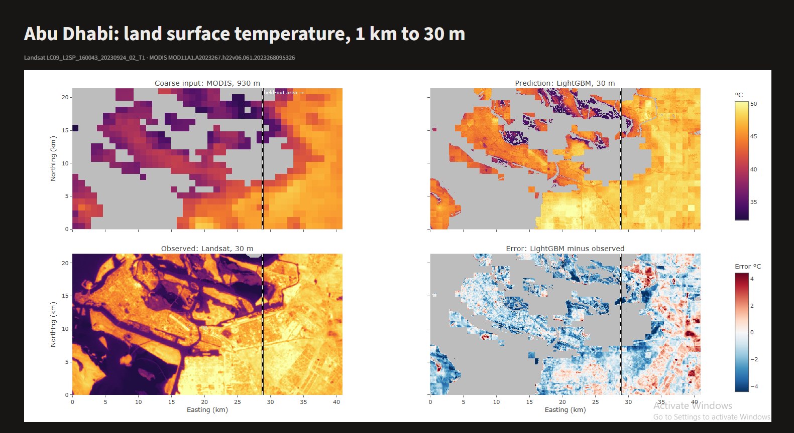
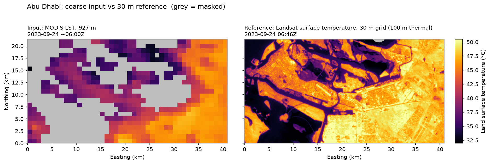

# urban-heat-downscaling

Estimating 30 m land surface temperature (LST) from roughly 1 km satellite LST, using fine-resolution vegetation, land cover and elevation. First city: Abu Dhabi.

**Status:** milestones 1-5 done: aligned data, fixed splits, bilinear, LightGBM and U-Net compared, and a dashboard (see [Roadmap](#roadmap)).

## Why

City heat varies block by block, but daily thermal satellites see it at about 1 km. Landsat sees it at about 100 m, but only every 8-16 days. This project learns how to map the daily coarse signal onto the fine urban texture, and measures how well that works on held-out areas and dates.

A note on what is being estimated: this is **land surface temperature** (the skin temperature of roofs, roads, sand and vegetation), not near-surface air temperature at 2 m. The two are related but different. Surface temperature is a key input to street-level air temperature models, which is where this work fits.

## Data

All sources are free and are read from [Microsoft Planetary Computer](https://planetarycomputer.microsoft.com/) STAC. No account is needed; URLs are signed automatically at read time.

| Layer | Product | Source resolution | Grid in this project | Resampling |
|---|---|---|---|---|
| Coarse input | MODIS Terra MOD11A1 v061 `LST_Day_1km` | 926.6 m | 930 m (31 x 30 m) | nearest |
| Reference | Landsat 8/9 Collection 2 Level-2 `ST_B10` | 30 m grid, **100 m effective thermal** | native 30 m | none |
| Vegetation | NDVI from Landsat SR `red`, `nir08` | 30 m | native 30 m | none |
| Land cover | ESA WorldCover v200 | 10 m | 30 m | nearest (categorical) |
| Elevation | Copernicus DEM GLO-30 | 30 m | 30 m | bilinear |

Units: all temperatures are stored in °C. Scale factors: Landsat ST `DN * 0.00341802 + 149.0` K; MODIS LST `DN * 0.02` K.

Masks:
- Landsat: `QA_PIXEL` fill, cloud, dilated cloud, cirrus, cloud shadow and snow removed; `ST_QA` uncertainty above 3 K removed.
- MODIS: `QC_Day` good quality kept; "other quality" kept only if the LST error class is 2 K or better.

Grids: the fine grid is the Landsat scene's own UTM 40N (EPSG:32640) 30 m grid, cropped to the city box and trimmed so that each 930 m coarse cell holds exactly 31 x 31 fine pixels. Terra (about 10:30 local solar time) is paired with Landsat (about 10:10) on the same day; the MODIS per-pixel view time is stored so the time gap can be reported.

## Setup

```bash
git clone https://github.com/SaraEwaida/urban-heat-downscaling.git
cd urban-heat-downscaling
python -m venv .venv && source .venv/bin/activate
pip install -e ".[dev]"
```

## Reproduce milestone 1

```bash
uhd fetch configs/abu_dhabi.yaml --list     # list clear same-day Landsat/MODIS pairs
uhd fetch configs/abu_dhabi.yaml --date 2023-09-24   # scene used below -> data/abu_dhabi/scene.json
uhd align configs/abu_dhabi.yaml            # aligned layers -> data/abu_dhabi/aligned.zarr
uhd preview configs/abu_dhabi.yaml          # figure -> outputs/figures/abu_dhabi_input_vs_reference.png
```

Without `--date`, `fetch` picks the clearest Landsat scene that has a same-day Terra pass.

`aligned.zarr` contains:

| Variable | Dims | Meaning |
|---|---|---|
| `lst_ref` | y, x | Landsat surface temperature, °C, NaN where masked |
| `valid_ref` | y, x | Landsat clear and low-uncertainty mask |
| `ndvi` | y, x | NDVI |
| `landcover` | y, x | WorldCover class code (0 = no data) |
| `elevation` | y, x | metres |
| `lst_coarse` | yc, xc | MODIS LST, °C, NaN where masked |
| `valid_coarse` | yc, xc | MODIS QC mask |
| `lst_coarse_on_fine` | y, x | coarse LST repeated onto the 30 m grid (no interpolation) |

Acquisition IDs and times, CRS, transforms, valid fractions and source tiles are kept in the dataset attributes.

## Reproduce milestone 2

```bash
uhd align-all configs/abu_dhabi.yaml   # all dates in `dates` on one grid -> data/abu_dhabi/stack.zarr
uhd baseline configs/abu_dhabi.yaml    # bilinear baseline -> outputs/results.csv, outputs/splits.json
```

`align-all` puts every date on the exact pixel grid of the first one and fails if a scene is offset by a fraction of a pixel. Land cover and elevation are stored once; the other layers gain a `time` axis.

### Splits

Defined in the config before any model is fitted, and shared by every method:

| Split | Area | Dates | Use |
|---|---|---|---|
| `train` | training area | training dates | fitting only |
| `test_area` | held-out area | training dates | new place |
| `test_dates` | training area | held-out dates | new day |
| `test_both` | held-out area | held-out dates | new place and new day |

- Held-out area: the eastern 30% of coarse columns. The boundary follows 930 m cell edges, so no input cell is shared between areas. Patch-based models must cut patches inside one split.
- Held-out dates: 2023-08-23 and 2023-09-24, the latest two, so testing is on later conditions than training.
- Scored pixels (the same for every method): clear Landsat, valid MODIS cell, and land (WorldCover water and no-data excluded).
- Errors are prediction minus observation, so a positive bias means too warm.

## Reproduce milestone 3

```bash
uhd lightgbm configs/abu_dhabi.yaml    # train, score every split -> outputs/results.csv
```

Also saves the model (`data/abu_dhabi/models/lightgbm.txt`), predictions for every date (`data/abu_dhabi/predictions/lightgbm.zarr`) and feature importance (`outputs/lightgbm_importance.csv`).

### LightGBM setup

- **Target:** Landsat temperature minus the bilinear surface. Trees cannot extrapolate, so the model learns a correction to the interpolated field rather than absolute temperatures.
- **Features (inputs only):** coarse cell value, bilinear value, the scene's mean coarse temperature, NDVI, elevation, land-cover class, and cell context: mean NDVI in the 930 m cell, the pixel's NDVI and elevation relative to its cell, and the cell's water, built-up, bare and vegetated fractions. Pixel coordinates are not used, so the model cannot memorise places.
- **Data use:** fitted on the `train` split without 2023-06-20; early stopping on 2023-06-20 in the training area. The test splits are only predicted. LightGBM needs no scaling, so there is no other preprocessing to fit.
- NDVI comes from the same Landsat scene as the reference temperature, as is standard for thermal downscaling studies. In operational use it would come from an independent optical image such as Sentinel-2.

## Reproduce milestone 4

```bash
pip install -e ".[dev,unet]"           # adds PyTorch
uhd unet configs/abu_dhabi.yaml        # train, score every split -> outputs/results.csv
```

Also saves the model with its normalisation (`data/abu_dhabi/models/unet.pt`), predictions (`data/abu_dhabi/predictions/unet.zarr`) and the per-epoch history (`outputs/unet_history.csv`). Runs on CPU in about 10-15 minutes and uses a CUDA GPU automatically when PyTorch can see one.

### U-Net setup

- **Same problem as LightGBM:** the same inputs as image channels (land cover as one-hot layers plus a valid-coarse-cell layer), the same residual target over bilinear, the same scored pixels and splits.
- **Network:** 3-level U-Net, 16 base channels (about 0.5 M parameters), masked mean squared error, AdamW, random flips and 90° rotations.
- **Patches:** 4 x 4 coarse cells (124 x 124 pixels, 3.7 km), cut in whole coarse cells after the splits are fixed. Training patches lie entirely inside the training area, with a 2-cell stride. For prediction each area is tiled separately and overlaps are averaged, so no patch ever mixes the two areas.
- **Data use:** channel means and standard deviations and the target scale are fitted on training pixels of the fitting dates only and saved with the model. The best epoch is chosen on 2023-06-20 in the training area. A test checks that changing held-out data leaves the normalisation unchanged.

## Dashboard

```bash
pip install -e ".[dashboard]"
streamlit run app/dashboard.py -- --config configs/abu_dhabi.yaml
```



- **Four linked maps:** coarse MODIS input, prediction, observed Landsat temperature, and signed error. Zooming or panning one map moves all four.
- **Scales:** one shared °C scale for every temperature map; a separate diverging scale for errors, centred on zero (blue = too cool, red = too warm).
- **Controls:** date (labelled as training, validation or held-out), method (bilinear, LightGBM, U-Net, whichever have been run), and display resolution.
- The dashed line marks the held-out area. Below the maps, MAE, RMSE and bias for the chosen date and method, separately for the training and held-out areas.

## Tests

```bash
pytest
```

The test builds synthetic rasters with the real products' CRSs, grids and encodings (UTM Landsat, sinusoidal MODIS, two geographic WorldCover tiles), runs the full alignment, and checks unit conversion, masks, categorical resampling, coarse/fine nesting, the Zarr round trip and the figure.

## Results

### Milestone 1: aligned scene, Abu Dhabi, 2023-09-24



- Pair: Landsat 9 `LC09_L2SP_160043_20230924_02_T1` and Terra `MOD11A1.A2023267.h22v06.061`.
- Grid: 713 x 1364 pixels at 30 m (about 21 x 41 km), 23 x 44 coarse cells at 930 m, EPSG:32640.
- Valid pixels: 99.8% of the Landsat reference, 61.9% of the MODIS cells.

Findings that shape the next steps:

- **MODIS gaps are water, not cloud.** Coverage stayed between 59% and 62% across eight clear summer dates. Masked cells are 64% water by WorldCover, against 10% in valid cells; MOD11A1 does not retrieve LST over sea, lagoons and channels. Training and evaluation therefore use land cells valid in both products.
- **Terra passes before Landsat.** On 2023-09-08 the MODIS view time was about 05:58Z against 06:46Z for Landsat, a gap of roughly 50 minutes during morning warming. The view time is stored per scene so the gap can be reported for every date.
- **MODIS reads cooler than Landsat over land**, by roughly 5-8 °C on hot surfaces in the first scenes. Viewing geometry, emissivity assumptions and the time gap all contribute. The models must correct this offset, and mean bias is reported for every method.

### Milestone 2: bilinear baseline, eight dates

All land pixels scored, °C, error = prediction minus Landsat:

| Method | Split | Pixels | MAE | RMSE | Bias |
|---|---|---:|---:|---:|---:|
| Bilinear | train | 1,693,717 | 9.18 | 10.16 | -9.09 |
| Bilinear | test_area | 1,499,384 | 6.12 | 7.09 | -6.01 |
| Bilinear | test_dates | 582,753 | 7.58 | 8.30 | -7.56 |
| Bilinear | test_both | 500,704 | 4.27 | 5.12 | -4.23 |

Per land-cover results are in `outputs/results.csv`.

- **The error is mostly a cold offset.** MAE is close to the absolute bias on every split: interpolated MODIS is 4-9 °C cooler than Landsat. With the mean bias removed, the remaining error is about 3-4.5 °C.
- **The offset depends on place and date.** It is largest in the western training area (island, coast, dense city) and in May-June, and smallest in the eastern desert and suburbs and in August-September. A single constant correction is not enough; the learned models have to explain it from vegetation, land cover, elevation and the coarse temperature.
- **Splits differ in difficulty**, so methods are compared within a split, not splits with each other. The held-out area has nearly as many scored pixels as the training area despite covering 30% of the box, because much of the western part is water and is not scored.

### Milestone 3: LightGBM vs bilinear

All land pixels scored, °C, error = prediction minus Landsat. The `train` row is in-sample.

| Split | Pixels | Bilinear MAE | LightGBM MAE | Bilinear RMSE | LightGBM RMSE | Bilinear bias | LightGBM bias |
|---|---:|---:|---:|---:|---:|---:|---:|
| train | 1,693,717 | 9.19 | 1.05 | 10.16 | 1.51 | -9.09 | -0.23 |
| test_area | 1,499,384 | 6.12 | **1.61** | 7.09 | **2.11** | -6.01 | **+0.35** |
| test_dates | 582,753 | 7.58 | **1.49** | 8.30 | **1.89** | -7.56 | **-0.66** |
| test_both | 500,704 | 4.27 | **1.54** | 5.12 | **2.01** | -4.23 | **+0.48** |

Per land-cover results are in `outputs/results.csv`; feature importance in `outputs/lightgbm_importance.csv`. Top features by gain: scene mean coarse LST 29%, land cover 14%, coarse cell value 11%, bilinear value 10%, NDVI 9%.

- **The cold offset is removed.** Bias falls from 4-9 °C to within ±0.7 °C on every held-out split.
- **Spatial detail improves, not just the offset.** With its mean bias subtracted, bilinear would still have an RMSE of about 3.8 °C (test_area), 3.4 °C (test_dates) and 2.9 °C (test_both). LightGBM reaches 2.1, 1.9 and 2.0 °C, so it places hot and cool surfaces better within each cell.
- **New place and new day behave alike**, with MAE between 1.5 and 1.6 °C on all three held-out splits.
- **Caveat:** the most important feature is the scene's mean coarse temperature, which lets the model learn how the MODIS-Landsat offset changes from day to day. That relation is learned from only five fitting dates (six with the validation date), all in May-June, and confirmed on two later dates. More dates across seasons are needed before relying on it.
- Early stopping chose 1,935 of the 2,000 allowed trees; the limit was not tuned.

### Milestone 4: all three methods

All land pixels scored, °C, error = prediction minus Landsat. The `train` row is in-sample for the learned models.

| Split | Method | MAE | RMSE | Bias |
|---|---|---:|---:|---:|
| test_area (new place) | Bilinear | 6.12 | 7.09 | -6.01 |
| | LightGBM | **1.61** | **2.11** | +0.35 |
| | U-Net | 2.07 | 2.62 | -0.83 |
| test_dates (new day) | Bilinear | 7.58 | 8.30 | -7.56 |
| | LightGBM | **1.49** | **1.89** | -0.66 |
| | U-Net | 1.50 | 1.96 | **+0.03** |
| test_both (new place and day) | Bilinear | 4.27 | 5.12 | -4.23 |
| | LightGBM | **1.54** | **2.01** | +0.48 |
| | U-Net | 1.55 | 2.03 | **-0.07** |
| train (in-sample) | Bilinear | 9.19 | 10.16 | -9.09 |
| | LightGBM | 1.05 | 1.51 | -0.23 |
| | U-Net | 1.67 | 2.23 | -0.27 |

The U-Net trained on 698 patches and its best epoch was 12 of 20 (`outputs/unet_history.csv`).

- **Both learned models are far better than interpolation**, cutting held-out MAE by a factor of 3 to 5 and removing most of the cold bias.
- **On new dates, LightGBM and the U-Net are level**, and the U-Net's bias is close to zero.
- **On the new area, LightGBM is clearly better.** The training area is mostly island, coast and dense city; the held-out east is mostly desert and suburbs. The U-Net learns neighbourhood patterns that transfer less well to a different landscape, while LightGBM judges each pixel from its own surface type and its cell context.
- **The U-Net is data-limited.** Five fitting dates give 698 patches, and validation on one date (43 patches) is noisy: validation RMSE moved between 2.8 and 3.9 °C from epoch to epoch, so the chosen epoch is uncertain.
- **LightGBM maps show faint 930 m blocks.** The raw coarse cell value is one of its features, and the steps between neighbouring cells carry into the prediction (visible in the dashboard error map). Dropping that feature in favour of the smooth bilinear value alone is a candidate fix.
- **Conclusion for now:** with eight dates, LightGBM is the better and cheaper model. More dates across seasons would test both the date-level offset learned by LightGBM and whether the U-Net closes the gap with more data.

## Roadmap

1. Aligned rasters and input-vs-reference view for one scene.
2. Eight dates for Abu Dhabi, held-out area and dates, bilinear baseline.
3. LightGBM on pixel features, fitted on the training split only.
4. PyTorch U-Net on image patches cut inside each split.
5. Comparison of all three methods on every split, overall and per land-cover class.
6. Streamlit dashboard: linked coarse-input and prediction maps on a shared °C scale, observed temperature and signed error (diverging scale) where reference data exists.
7. Next: more dates across seasons, to test the learned day-to-day offset and give the U-Net more data.

## Layout

```
configs/            city configs (bbox, search window, QA thresholds, paths)
src/uhd/
  products.py       scale factors, fill values, QA bit decoding
  fetch.py          STAC search and Landsat/MODIS pairing -> scene manifest
  align.py          grid definition, warping, masking -> Zarr
  preview.py        input vs reference figure
  stack.py          multi-date alignment on one grid
  splits.py         held-out area and dates, shared evaluation mask
  baseline.py       bilinear interpolation baseline
  features.py       per-pixel features with 930 m cell context
  lgbm.py           LightGBM residual model: fit, early stopping, prediction
  unet.py           U-Net: normalisation, split-safe patches, training, tiled prediction
  dashboard.py      dashboard data and linked map figure
app/dashboard.py    Streamlit app
  metrics.py        MAE, RMSE, bias overall and per land-cover class
  cli.py            `uhd` command
tests/              synthetic end-to-end tests (conftest.py builds the fake products)
```
